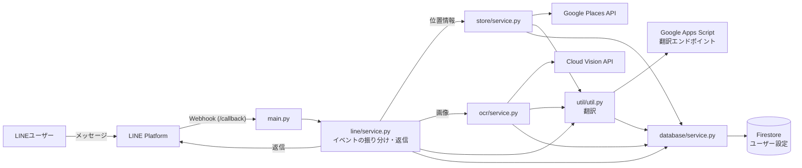

# line-bot-features

LINE Messaging APIで動くPython / Flask製のチャットボットです。送られた位置情報の周辺でトイレのあるコンビニを探す機能と、画像の文字を読み取って翻訳する機能があります。

## 機能

| ユーザーが送るもの | ボットの返信 |
| --- | --- |
| 位置情報 | Google Places APIで「トイレ」をキーワードに周辺のコンビニを検索し、最大5件をカルーセルで返す。各店舗の営業中かどうか・評価・Googleマップへのリンクを表示する。キーワードは店名や口コミなどGoogleが持つ情報と照合するもので、トイレがある店でも見つからないことがあるため、見つからないときはキーワードなしで周辺のコンビニを探し、トイレの有無は確かめられていないことを添えて返す |
| 画像 | Google Cloud Vision APIで画像内の文字を読み取り、ユーザーが設定した言語に翻訳して返す |
| テキスト・動画・音声 | 使い方の案内を返す |
| スタンプ | 同じスタンプを返す |
| メニューの「Setting」 | 表示言語とコンビニの検索範囲（0.3km〜3km）を選び、Firestoreに保存する |

メッセージへの返信と設定を保存したときの返信には、クイックリプライのメニュー（トイレ付きコンビニ検索・撮って翻訳・選択して翻訳・Setting）を付けます。設定の途中では、メニューの代わりに設定項目や選択肢をクイックリプライで表示します。設定した言語が日本語以外なら、返信文をGoogle Apps Scriptの翻訳エンドポイントで翻訳します。処理中に例外が起きたときは、固定のエラーメッセージを翻訳せず、メニューも付けずに返します。

## 処理の流れ



## 必要な設定

`.env` は自動では読み込まないため、次の環境変数をシェルまたは実行環境に設定します。Sentryの環境変数は `monitoring.py`、それ以外は `const/env.py` で読み込みます。`.env.example` にはSentryの設定例だけを記載しています。

| 用途 | 環境変数 |
| --- | --- |
| LINE Messaging API | `LINE_CHANNEL_SECRET`・`LINE_CHANNEL_ACCESS_TOKEN`（どちらかが空なら起動を中止） |
| Firestore（Firebaseのサービスアカウント） | `FIREBASE_PROJECT_ID`・`FIREBASE_PRIVATE_KEY` など `FIREBASE_` で始まる各項目 |
| Google Places API・Cloud Vision API | `GOOGLE_API_KEY` |
| 翻訳（Google Apps Script） | `GOOGLE_APP_SCRIPTS_ENDPOINT` |
| Sentryへのエラー送信 | `SENTRY_DSN` など（[docs/monitoring.md](docs/monitoring.md)） |
| 待ち受けポート | `PORT`（既定値 5000） |

## セットアップと起動

`.python-version` のPythonで仮想環境を作り、依存パッケージをインストールします。エディタの設定は [docs/python-environment.md](docs/python-environment.md) を参照してください。

```bash
python3.12 -m venv .venv
.venv/bin/python -m pip install -r requirements.txt
```

次のコマンドでFlaskの開発サーバーを起動します。サーバーは `0.0.0.0` の、環境変数 `PORT` で指定したポートで待ち受け、`/callback` でWebhookを受けます。環境変数で指定したLINEチャネル・Firestore・Google APIに実際に接続するため、接続先を確認してから起動してください。

```bash
.venv/bin/python main.py
```

## テスト

```bash
.venv/bin/python -m unittest discover -s tests -v
```

テストは外部サービスをフェイクに置き換え、実際のLINE・Firestore・Google API・Sentryには接続しません。`tests/test_gunicorn.py` はlocalhostでGunicornと模擬のSentry受信サーバーを起動します。CIで実行する内容は [.github/workflows/test.yml](.github/workflows/test.yml)、テストで確認している内容は [docs/monitoring.md](docs/monitoring.md#ローカルでの追加検証) を参照してください。

## ディレクトリ構成

| パス | 内容 |
| --- | --- |
| `main.py` | Flaskアプリ。`/callback` で署名を検証し、イベントを `line/` に渡す |
| `line/` | イベントの種類ごとの処理、返信とクイックリプライの作成 |
| `store/` | コンビニ検索（Google Places API） |
| `ocr/` | 画像の文字認識（Cloud Vision API） |
| `util/` | 翻訳 |
| `database/` | Firestoreのユーザー設定の読み書き |
| `const/` | 環境変数、Firebaseの初期化、返信文・メニューの定数 |
| `monitoring.py` | Sentryへのエラー送信 |
| `gunicorn.conf.py` | Gunicornの設定 |
| `scripts/sentry_smoke.py` | デプロイ後にSentryへ合成エラーを1件送る確認用スクリプト |
| `tests/` | テスト |
| `docs/` | エラー監視とPython環境の説明 |
